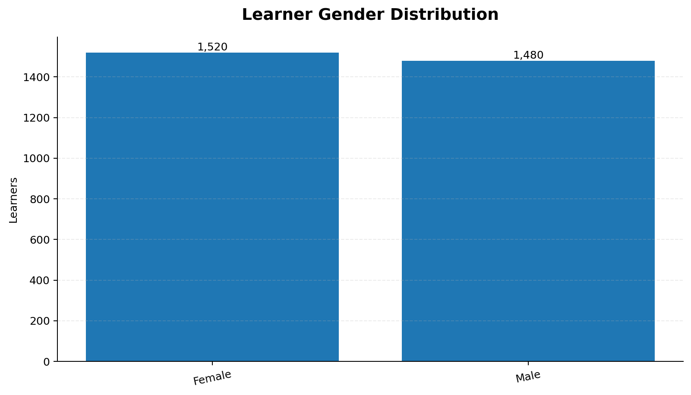
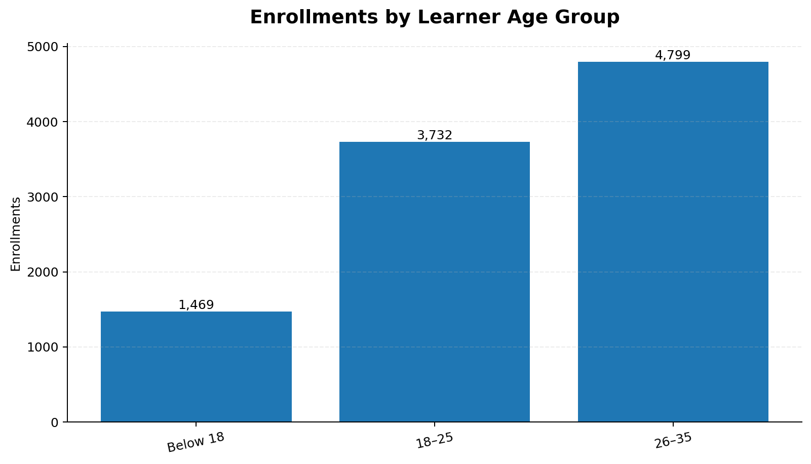
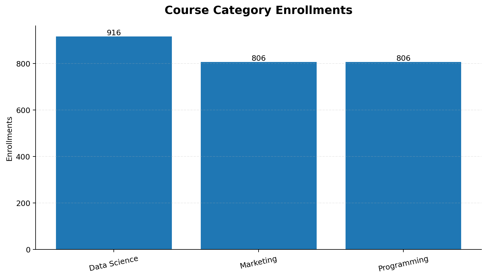
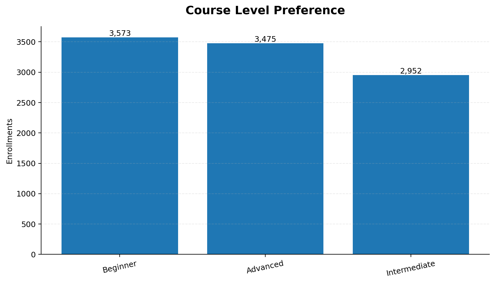
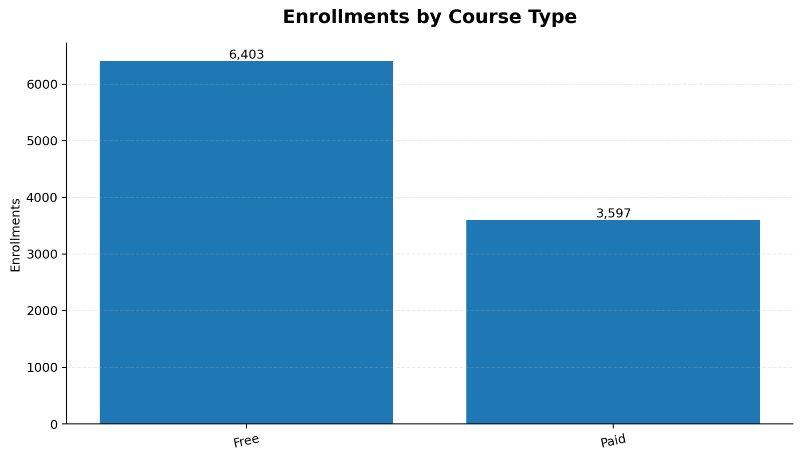
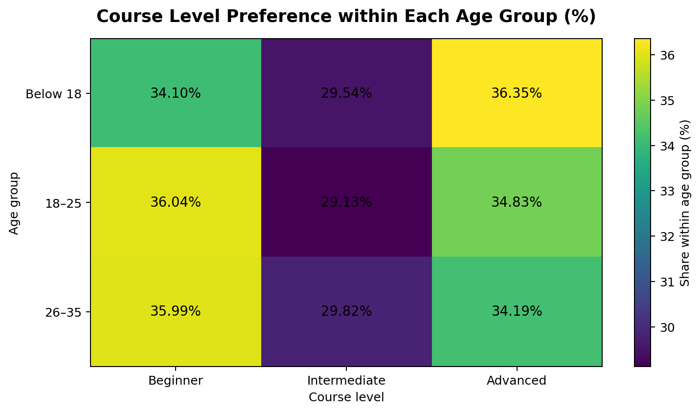
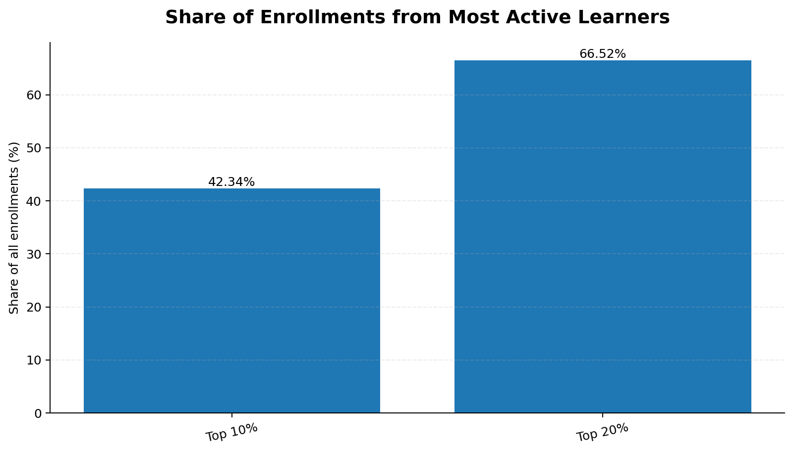
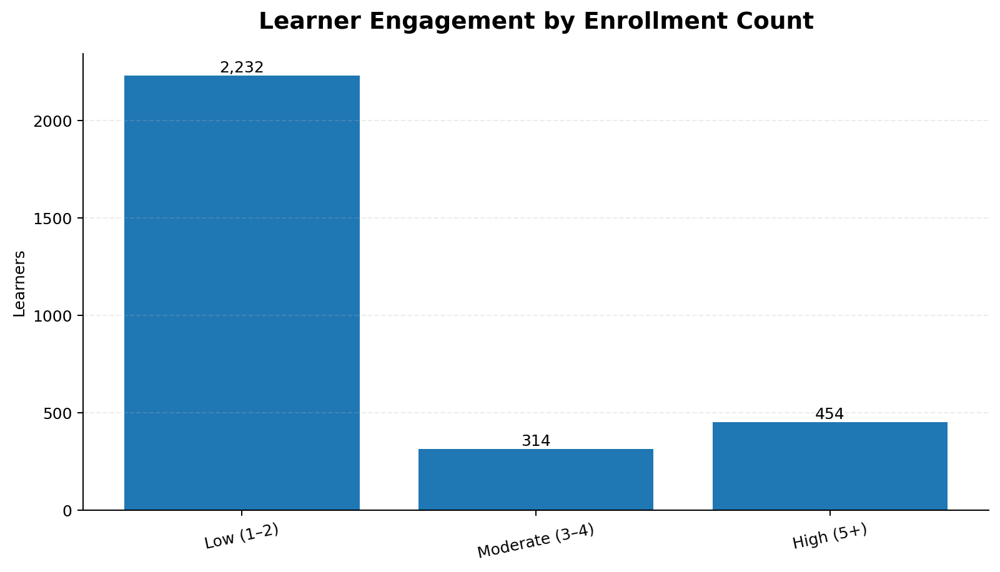

# EduPro – Learner Demographics and Course Enrollment Behavior Analysis

An end-to-end descriptive analytics project that explores learner demographics, online course choices and enrollment behaviour. The work moves from spreadsheet data checks and exploratory analysis to an interactive Streamlit dashboard, a research paper and an executive summary.

> **Project focus:** understanding the patterns present in the supplied dataset. This is a descriptive analytics project; it does not train a prediction model or forecast revenue.

## Project at a glance

| Item | Details |
|---|---:|
| Learner records | 3,000 |
| Course records | 60 |
| Teacher records | 60 |
| Transaction / enrollment records | 10,000 |
| Average enrollments per learner | 3.33 |

## What this project tries to understand

The project explores a few practical questions:

- Which learner age groups account for more enrollments?
- How is learner participation distributed by gender?
- Which course categories, course types and course levels are selected more often?
- Do course-level choices look different across age groups or genders?
- Are enrollments spread evenly across learners, or are they concentrated among a smaller group?
- How many enrollments does a learner make on average?

## Live Dashboard

Explore the interactive EduPro Learner Analytics dashboard:

"Open EduPro – Learner Analytics Dashboard" (https://edupro-learner-analytics-26.streamlit.app/)

The dashboard allows users to explore learner demographics, course preferences, enrollment patterns and learner behaviour through interactive visualisations and filters.

## Dataset and data preparation

The workbook contains four sheets:

| Sheet | Records | Main fields used |
|---|---:|---|
| Users | 3,000 | UserID, Age, Gender |
| Teachers | 60 | TeacherID, Age, Gender, Expertise, YearsOfExperience, TeacherRating |
| Courses | 60 | CourseID, CourseName, CourseCategory, CourseType, CourseLevel, CoursePrice, CourseDuration, CourseRating |
| Transactions | 10,000 | TransactionID, UserID, CourseID, TransactionDate, Amount, PaymentMethod, TeacherID |

The analysis connects transaction records with learner and course information using `UserID` and `CourseID`. The notebook also checks table structure, data types, missing values, duplicate records, key uniqueness and whether the IDs used for joining are valid.

The integrated learner-enrollment-course data is then used for the demographic and course preference analysis. Teacher fields are retained in the source workbook, although the main dashboard questions focus on learners and course enrollments.

## Analysis workflow

### 1. Data understanding and integration

- Loaded the four workbook sheets.
- Reviewed dimensions, columns, data types and sample records.
- Checked missing values and duplicate records.
- Checked key uniqueness and ID relationships.
- Joined learner, transaction and course information for analysis.

### 2. Exploratory data analysis

- Learner age-group distribution.
- Gender participation.
- Enrollments by course category.
- Enrollments by course type and course level.
- Overall enrollment activity.
- Learner enrollment frequency.
- Age group versus course category.
- Gender versus course level.

### 3. Learner behaviour analysis

- Measured how enrollments are distributed across learners.
- Compared the number of learners participating in Beginner, Intermediate and Advanced courses.
- Calculated average enrollments per learner within each course level.
- Grouped learners by enrollment count to describe activity levels.

### 4. KPI summary and interpretation

The final notebook section brings the main metrics together and explains what the charts show. The interpretations are descriptive: they report patterns in this dataset and do not claim to measure satisfaction, course completion or learning outcomes.

## Key findings

### Overall numbers

| KPI | Result |
|---|---:|
| Total learners | 3,000 |
| Total enrollments | 10,000 |
| Average enrollments per learner | 3.33 |
| Most active age group by enrollment | 26–35 |
| Most enrolled category | Data Science |
| Most enrolled course level | Beginner |
| Higher enrollment course type | Free |

### Learner demographics

The learner dataset contains 1,520 female learners and 1,480 male learners. The largest age group is 26–35, with 1,446 learners, followed by 18–25 with 1,121 learners and Below 18 with 433 learners.



### Enrollments by age group

| Age group | Enrollments |
|---|---:|
| Below 18 | 1,469 |
| 18–25 | 3,732 |
| 26–35 | 4,799 |
| 36–45 | 0 |
| Above 45 | 0 |

The 26–35 age group accounts for the largest share of enrollments in this dataset.



### Course category preference

Data Science recorded 916 enrollments. Marketing and Programming recorded 806 enrollments each.



### Course level preference

| Course level | Enrollments | Share |
|---|---:|---:|
| Beginner | 3,573 | 35.73% |
| Advanced | 3,475 | 34.75% |
| Intermediate | 2,952 | 29.52% |

Beginner courses have the highest enrollment count, although Advanced courses are close behind.



### Course type

Free courses account for 6,403 enrollments, while paid courses account for 3,597.



### Age group and course-level preference

The percentages below show the course-level mix within each age group.

| Age group | Beginner | Intermediate | Advanced |
|---|---:|---:|---:|
| Below 18 | 34.10% | 29.54% | 36.35% |
| 18–25 | 36.04% | 29.13% | 34.83% |
| 26–35 | 35.99% | 29.82% | 34.19% |



The pattern is fairly similar across the three age groups shown. Advanced has the highest share for learners below 18, while Beginner has the highest share in the 18–25 and 26–35 groups.

### Enrollment concentration

Enrollments are not evenly distributed across learners:

- The top 10% of learners account for 42.34% of all enrollments.
- The top 20% of learners account for 66.52% of all enrollments.



This indicates that a relatively small group of learners contributes a large share of recorded enrollments.

### Learner engagement segments

Learners were grouped using their total enrollment count:

| Segment | Rule | Learners | Share |
|---|---|---:|---:|
| Low | 1–2 enrollments | 2,232 | 74.40% |
| Moderate | 3–4 enrollments | 314 | 10.47% |
| High | 5 or more enrollments | 454 | 15.13% |



These labels describe enrollment activity only. They should not be read as measures of satisfaction, course completion or learning success.

### Beginner, Intermediate and Advanced participation

| Course level | Unique learners | Average enrollments per participating learner |
|---|---:|---:|
| Beginner | 1,596 | 2.24 |
| Advanced | 1,608 | 2.16 |
| Intermediate | 1,464 | 2.02 |

A learner can enroll in courses from more than one level. For this reason, the unique learner counts overlap and their percentages do not add up to 100%.

## Interactive Streamlit dashboard

The dashboard is designed to make the findings easier to explore without needing to run the notebook. Its sections include:

- **Overview:** headline KPIs and key findings.
- **Demographics:** age-group and gender patterns.
- **Course Preferences:** category, course type and course-level analysis.
- **Learner Behaviour:** enrollment frequency, concentration and engagement groups.
- **Data & Export:** dataset viewing and available export options.

The dashboard includes filters for relevant learner and course attributes, and charts are accompanied by short explanations. The exact available controls depend on the current `app.py` version.

## Tools used

- Python
- Pandas
- NumPy
- Matplotlib
- Plotly
- Streamlit
- OpenPyXL
- Jupyter Notebook / Google Colab
- Visual Studio Code
- GitHub


## Run the dashboard on your computer

### 1. Clone the repository

```bash
git clone https://github.com/devrishi610/EduPro-Learner-Analytics.git
cd EduPro-Learner-Analytics
```

### 2. Install the dashboard requirements

```bash
pip install -r 04_Streamlit_Dashboard/requirements.txt
```

### 3. Start Streamlit

```bash
python -m streamlit run 04_Streamlit_Dashboard/app.py
```

Open the local address shown in the terminal. Streamlit commonly uses `http://localhost:8501`.

The workbook should remain in the repository root and keep the filename `EduPro_Online_Platform_Master.xlsx`, because the dashboard code is configured to read that file from the project root.

## Project documents

- **Notebook:** the step-by-step data checks, integration, EDA, behaviour analysis and KPI summary.
- **Research paper:** a fuller written explanation of the project, approach and findings.
- **Executive summary:** a shorter overview of the work and its main results.
- **Dashboard:** an interactive way to explore the analysis.

## Scope and limitations

- The results describe the workbook used for this project. They should not automatically be generalised to every online learning platform.
- No prediction model is trained in this project.
- Enrollment counts are used as a measure of recorded course activity; they do not show whether a learner completed a course or was satisfied with it.
- Learners may appear in more than one course level, so level-wise unique learner counts overlap.
- The age bands 36–45 and Above 45 have zero enrollments in the analyzed records.

## Prepared By

**Dev Rishi Mishra**  
M.Sc. Mathematics  

## Acknowledgement

Thanks to the project team for providing the project brief and dataset used for this analysis.
